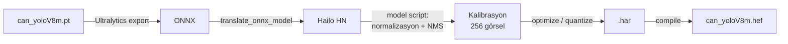

# ⚡ YOLOv8 (.pt) → Hailo-8 (.hef) Dönüştürücü

**HÜRTÜRK İHA Takımı** · TEKNOFEST Savaşan İHA

Kendi eğittiğimiz YOLOv8 İHA tespit modelini, Raspberry Pi 5 + Hailo-8 (AI Kit) üzerinde gerçek zamanlı çalıştırmak için `.hef` formatına derleyen script. Dönüşüm Hailo Dataflow Compiler (DFC) ile bir Ubuntu PC'de yapılır, çıkan `.hef` dosyası Pi'ye kopyalanır.

---

## 🔄 Akış



1. **ONNX export:** `.pt` modeli 640×640, opset 11 ile ONNX'e çevrilir.
2. **Parse:** ONNX, YOLOv8 tespit kafasının 6 çıkış katmanından kesilerek Hailo formatına çevrilir.
3. **Model script:** Giriş normalizasyonu (0–255 → 0–1), sınıf çıkışlarına sigmoid ve Hailo'nun NMS son işlemesi eklenir. Derleyici en yüksek optimizasyon seviyesine ayarlanır.
4. **Kalibrasyon:** Veri setinden rastgele, tekrarsız 256 görsel seçilerek INT8 kuantizasyon için kalibrasyon seti oluşturulur.
5. **Optimize ve derle:** Model kuantize edilir (`.har`) ve Hailo-8 için `.hef` dosyasına derlenir.

---

## 📂 Dosyalar

| Dosya | Açıklama |
| :--- | :--- |
| `dön_yedek.py` | Dönüştürme script'i (yukarıdaki 6 adım) |
| `hailo_yolov8m_480_640_nms_config.json` | Hailo NMS ayarları — tek sınıf (`iha`), skor eşiği 0.1, IoU 0.6 |
| `canM.yaml` | Kalibrasyon görsellerinin bulunduğu veri seti tanımı |

---

## 🚀 Kullanım

**Gereksinimler:** Ubuntu, Hailo Dataflow Compiler (`hailo_sdk_client`), `ultralytics`, `numpy`, `Pillow`

1. Eğitilmiş modeli (`can_yoloV8m.pt`) script ile aynı klasöre koy.
2. Kalibrasyon görsellerini bir klasöre koy ve `canM.yaml` içindeki `path` ile script'teki `calib_dir` yolunu kendi klasörüne göre güncelle.
3. Çalıştır:
   ```bash
   python3 dön_yedek.py
   ```
4. Çıkan `can_yoloV8m.hef` dosyasını Raspberry Pi 5'e kopyala.

> 💡 **Not:** Kalibrasyonda görseller doğrudan 640×640'a yeniden boyutlandırılıyor (stretch). Pi'de çalışırken de aynı ön işleme kullanılmalı; letterbox gibi farklı bir yöntem kullanılırsa doğruluk düşer.

> ⚠️ Model ağırlıkları (`.pt`) ve derlenmiş `.hef` dosyaları repoda yok.

---

**Geliştiren:** [Can Ahmet Atik](https://github.com/canahmet1407) — HÜRTÜRK İHA Takımı Görüntü İşleme Lideri
